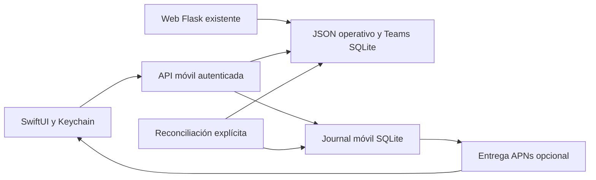

# ADR: complemento nativo de Flowing para iPhone

Fecha: 10 de octubre de 2026. Estado: primer incremento compilado y ejecutado en Simulator iOS 26, con sesión nativa conectada al fixture HTTPS sintético y capturas reales. Consulta de Inicio, listas y avisos observada; operaciones completas continúan en web. Ajustes de revisión visual verificados dentro del alcance de las capturas iPhone 16; no hay certificación de toda la superficie. Pendientes firma de distribución y validación física/APNs. Seguimiento en [Compilación y QA](05-compilacion-y-qa.md).

## Decisión

SwiftUI para las pantallas de iPhone; Flask conserva reglas, datos e integraciones. API `/api/mobile/` incremental y desactivada por defecto. La solicitud directa del usuario prioriza una aplicación con experiencia propia; por ello se adelanta el cliente nativo respecto al orden PWA→Capacitor del documento inicial. La web y su PWA continúan intactas.

| Alternativa | Ventaja | Limitación en este repositorio | Decisión |
| --- | --- | --- | --- |
| PWA + Web Push | Reutiliza páginas y acceso actual. WebKit permite push para apps de pantalla de inicio desde iOS 16.4. | No satisface por sí sola la experiencia nativa pedida. | Puede evolucionar después, con adaptador separado para evitar duplicación. |
| Capacitor | Puente nativo y posible reutilización de frontend compilado. | Aquí las páginas se generan en Flask; cargar la web remota deja un contenedor web. Crear un frontend independiente igualmente exige trabajo. | No elegido para este incremento. |
| SwiftUI + API existente | Navegación, listas, controles, Keychain y APNs propios de iPhone. | Cliente adicional que mantener; no reutiliza HTML. | Elegido, sin reescribir backend ni duplicar reglas de dinero. |

[Capacitor](https://capacitorjs.com/docs), [WebKit](https://webkit.org/blog/13878/web-push-for-web-apps-on-ios-and-ipados/). Apple exige utilidad y experiencia que superen una web reempaquetada; implementar SwiftUI no garantiza aprobación. [App Review, 4.2](https://developer.apple.com/app-store/review/guidelines/#minimum-functionality).

## Componentes

Cliente actualizado el 11 de octubre: Inicio, Leads, Teams, Calendario, Más; Trabajos accesible desde Inicio y Más, y Clientes/Pagos/Notificaciones/Preferencias desde Más. Teams ofrece Coberturas próximas/pasadas/todas y Equipo, con detalle de miembros y asignaciones, horarios, estado, conflictos y honorarios. Detalles en navegación nativa. Edición, archivos, contratos y demás operaciones complejas abren la ficha web durante esta etapa. No se promete paridad funcional completa todavía.

API: sesión, resumen y listas por empresa; pagos reutilizan `_visible_billable_payments`, `_payment_financial_summary`, `coerce_amount`; clientes, trabajos y fechas proyectan campos mínimos. La bandeja móvil es persistente y separada de la bandeja web actual: las lecturas todavía no se sincronizan entre ambas.

API Teams: `/api/mobile/teams` es de lectura y proyecta una allowlist del snapshot existente. La empresa se pasa explícitamente desde la identidad bearer; respeta flags y guardas locales Teams. Conserva cálculos en centavos e indicador de costes parciales. No añade envíos de invitaciones, pagos ni mutaciones de asignaciones. QA sintético y HTTPS aprobados. El contraste de Cobertura y Miembro quedó corregido y verificado: 21:1 en claro y 17.01:1 en oscuro. Dictamen favorable limitado a las capturas Teams revisadas en Simulator iPhone 16; no incluye la sección inferior no revisada ni toda la app.

## Conexión y aislamiento

1. iPhone solicita secreto de dispositivo de 256 bits y código visible de 8 caracteres, válido 10 minutos. El servidor conserva el hash del secreto.
2. Propietario inicia sesión en el CRM mediante Google y autoriza expresamente el código mediante formulario con CSRF. La empresa y el correo salen de esa sesión, no del iPhone.
3. Polling cada 5 segundos entrega una sola vez el bearer, con duración de 30 días. Hash en servidor, Keychain en iPhone, sin cookies web en URLSession ni bearer en URL.
4. Cada petición revalida empresa activa y `login_email` vigente. Un bearer solo sirve en las rutas móviles. Si coexiste una cookie web de otra marca, prima la identidad autenticada del bearer sin modificar esa cookie.
5. Cerrar sesión revoca bearer y elimina token push del servidor. Un token APNs se desvincula de sesiones anteriores al registrarse con otra cuenta. Una revisión de configuración evita que un registro pendiente revierta la desactivación o la privacidad; las respuestas de una sesión anterior se descartan también en la app. Notificaciones ya aceptadas por APNs o presentes en el sistema operativo no se pueden retirar mediante esta revocación.

No se cambió el login Google ni se añadió un redirect OAuth de Apple/Google. La conexión inicial usa Safari y aprobación de código; un login móvil integrado y selección entre cuentas autorizadas son un hito posterior.

## Notificaciones

Journal SQLite separado bajo `CRM_DATA_DIR/mobile.sqlite3`: pairings, sessions, observed, baselines, notifications, preferences y deliveries. Creación aditiva/idempotente al primer uso autorizado, permiso de archivo 0600. No migra ni reescribe tablas del CRM.

Evento persistido → reconciliación → observación + notificación + cola en una transacción SQLite → lease → revalidación de destinatario, preferencia, estado de origen y caducidad → APNs. Entrega aceptada/pendiente/reintento/fallida/cancelada diferenciadas. Reintentos exponenciales, máximo 5 intentos, lease de 120 segundos y cola fallida consultable en SQLite.

Timeout ambiguo puede reenviar: se usa `apns-id` estable y collapse-id por aviso, pero no se promete entrega exactamente una vez. Aceptación del proveedor no acredita visualización ni lectura. Caducidad general de cola: 7 días; validez APNs: 1 hora. El aviso predeterminado oculta detalles y transporta solo ID de notificación, sin URLs ni tokens. El toque resuelve el registro a través de la API y vuelve a validar pertenencia.

Push APNs cifrado en reposo con Fernet y clave dedicada del servidor; firma ES256 con clave P-256 y transporte HTTP/2. Solo el servidor conoce la clave de Apple. Entornos sandbox/production separados por build. [Documentación APNs](https://developer.apple.com/documentation/usernotifications/establishing-a-token-based-connection-to-apns).

## Límites antes de producción

- Rate limit de enrolamiento por origen (5 por minuto), aprobación por propietario (10 por minuto), cap global (500 códigos vivos) y polling individual. Revisar el proxy para que los límites por origen identifiquen correctamente las conexiones en staging.
- Definir retención y purga de sesiones, historial y delivery logs; quiet hours y gestión de todos los dispositivos son pendientes.
- Un worker en el mismo almacenamiento, con supervisión y healthchecks. Inicializar baseline antes de probar eventos. No activar desde imports de Flask.
- Coordinar cancelaciones con cambios intermedios y tratar importaciones que no usen marcadores conocidos. El scanner inicial no sustituye un bus transaccional completo.
- Probar UI en Simulator claro/oscuro/Dynamic Type y confirmar recepción real con iPhone instalado y cerrado.

## Distribución y cuentas

Desarrollo local mediante Xcode; después prueba privada y TestFlight, y finalmente App Store si el propietario lo decide. La membresía Apple Developer indicada por Apple cuesta USD 99 al año, sujeta a precio regional. No es una compra realizada ni autorización de gasto. [Apple Developer Program](https://developer.apple.com/programs/enroll/).

No hay nuevas suscripciones comerciales en el código: Foundation, SwiftUI y SQLite; dependencia opcional `httpx[http2]` para el servidor. Capacidad/hosting del worker y almacenamiento pueden exigir coste adicional según despliegue, pendiente de verificar. Android queda para un cliente posterior que reutilice esta API, sin prometer proyecto Android ya creado.
